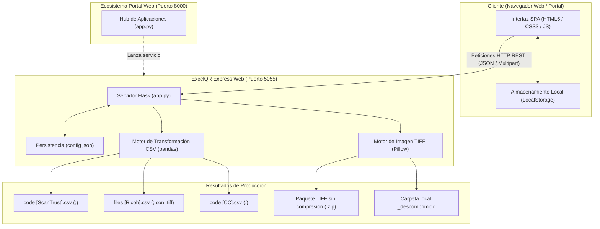

# 🏗️ Documento Técnico de Arquitectura y Diseño
## Sistema ExcelQR Express Web (v6.4.2)

---

### 1. Visión General de la Arquitectura
**ExcelQR Express Web** está estructurado bajo una arquitectura de microservicio web desacoplada en dos capas:
1. **Frontend SPA (Single Page Application):** Interfaz ligera y reactiva basada en HTML5, CSS3 nativo y JavaScript moderno (ES6+), sin sobrecargas de frameworks pesados, garantizando máxima velocidad y compatibilidad en cualquier navegador.
2. **Backend API (Flask / Python 3):** Servidor HTTP RESTful encargado de la lógica de negocio, validaciones matemáticas, transformaciones tabulares con pandas y manipulación de imágenes a bajo nivel con Pillow (PIL).

---

### 2. Componentes del Sistema

#### 2.1. Capa de Presentación (Frontend)
* **Archivo base:** `templates/index.html`
* **Estilos:** `static/css/style.css` (implementa CSS Grid, Flexbox, variables CSS y diseño responsive compatible con temas oscuros de producción).
* **Controlador cliente:** `static/js/app.js`
  * Inspección previa de archivos CSV (`/api/csv/inspect`) antes del envío de datos pesados.
  * Sincronización bidireccional de folios (LocalStorage del navegador $\leftrightarrow$ `config.json` del servidor).
  * Manejo asíncrono de descargas binarias mediante objetos `Blob` y URLs temporales (`window.URL.createObjectURL`).

#### 2.2. Capa de Servicios y API (Backend)
* **Punto de entrada:** `app.py`
* **Tecnología base:** Python 3.10+ con Flask 3.x.
* **Librerías principales:**
  * `pandas`: Ingestión de archivos delimitados, vectorización de series e iteración de alta velocidad.
  * `Pillow (PIL)`: Decodificación y serialización en formato TIFF de imágenes provenientes de cualquier formato (`JPEG`, `PNG`, `BMP`, `WEBP`).
  * `zipfile`: Empaquetado y descompresión en streaming de lotes de imágenes.
  * `tempfile` / `shutil`: Creación y destrucción segura de directorios efímeros para evitar fugas de espacio en disco.

---

### 3. Modelo de Procesamiento y Flujos de Datos

#### 3.1. Flujo de Transformación CSV
1. **Inspección preliminar:** El cliente envía el archivo al endpoint `/api/csv/inspect`. El servidor lee los primeros bloques con pandas, calcula la longitud total de filas y retorna los nombres de columnas.
2. **Validación matemática de folios:**
   $$\Delta \text{Folios} = \text{Folio Final} - \text{Folio Inicial} + 1$$
   $$\text{Condición de validez:} \quad \Delta \text{Folios} \equiv N_{\text{filas CSV}}$$
   Si la condición no se cumple estrictamente, la petición es rechazada con código HTTP 400 y mensaje explicativo.
3. **Mapeo vectorial:** Se generan las nuevas columnas correspondientes al estándar de la máquina de destino.
4. **Respuesta en streaming:** El DataFrame resultante es serializado en memoria a través de un `io.StringIO` y devuelto con cabeceras `Content-Disposition: attachment`.

#### 3.2. Flujo de Conversión de Imágenes a TIFF de Imprenta
1. **Recepción:** El backend recibe imágenes individuales o un contenedor `.zip`.
2. **Decodificación y normalización:**
   * Detección del modo de color: si la imagen de entrada contiene canal alfa (`RGBA`) o paleta indexada (`P`), se convierte automáticamente a espacio de color puro `RGB` para evitar errores de interpretación en el procesador de imágenes de trama (RIP).
3. **Compresión y extensión:**
   * Parámetro de guardado: `img.save(path, 'TIFF', compression=None)`.
   * Extensión de archivo: forzada a `.tiff` en minúsculas con doble letra 'f'.
4. **Empaquetado:** Se consolida en un archivo ZIP temporal y se transmite al cliente. Al terminar la transmisión, el bloque `finally` garantiza la eliminación del directorio temporal del sistema operativo.

---

### 4. Seguridad y Rendimiento

* **Límite de Carga:** Configurado en `MAX_CONTENT_LENGTH = 500 * 1024 * 1024` (500 MB) para prevenir ataques de denegación de servicio por agotamiento de memoria.
* **Saneamiento de nombres de archivo:** Todas las cargas externas pasan por `werkzeug.utils.secure_filename` para impedir ataques de tipo *Directory Traversal* (`../`).
* **Operaciones libres de bloqueo (Non-blocking file handlers):** Uso estricto de gestores de contexto `with` para la apertura y cierre inmediato de descriptores de archivo en Windows (`Image.open`, `open()`), evitando archivos bloqueados en el explorador del sistema.
* **Concurrencia y puerto:** El microservicio corre en `0.0.0.0:5055`, permitiendo ser consumido tanto por la máquina local (`localhost`) como por otros equipos dentro de la misma red local corporativa.
